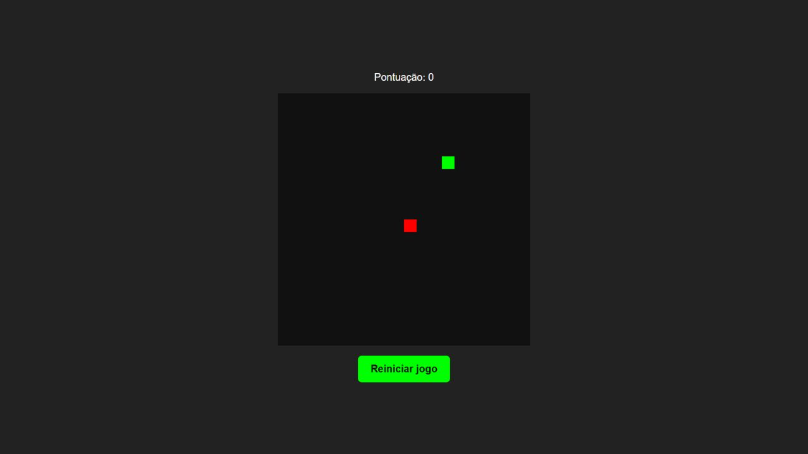

# Jogo da Cobrinha

Jogo da cobrinha feito com **HTML, CSS e JavaScript**, usando o **canvas** para desenhar o tabuleiro, a cobra e a comida.

Projeto de estudo desenvolvido passo a passo com orientação, como parte do meu aprendizado de desenvolvimento web. O foco foi entender a lógica do jogo e escrever o código, sem frameworks ou bibliotecas externas.



## Como jogar

- Use as setas do teclado para controlar a cobra.
- Cada comida vermelha vale um ponto e aumenta o corpo em um segmento.
- Ao atravessar uma borda, a cobra reaparece do lado oposto.
- Bater no próprio corpo encerra a partida.
- O botão **Reiniciar jogo** começa uma nova partida.
- Preencher o tabuleiro inteiro encerra o jogo com uma vitória.

O jogo começa automaticamente ao abrir a página. Foi desenvolvido para jogar com teclado; ainda não possui controles de toque para celular.

## Tecnologias

- **HTML:** estrutura da página e elemento `canvas`.
- **CSS:** cores, alinhamento e aparência do botão.
- **JavaScript:** movimento, teclado, comida, crescimento, pontuação e colisão.

## O que pratiquei

- Variáveis com `let` e `const`.
- Funções, parâmetros, condições e operadores lógicos.
- Arrays e objetos para representar os segmentos da cobra.
- Repetições com `for...of` e `do...while`.
- Eventos de teclado e clique com `addEventListener`.
- Desenho em duas dimensões com `getContext("2d")`.
- Atualização do placar pelo DOM.
- Temporização com `setInterval` e `clearInterval`.

## Executar no computador

Baixe o repositório e abra o arquivo `index.html` no navegador. Não é necessário instalar dependências ou executar uma etapa de compilação.

Outra opção é abrir a pasta no VS Code e iniciar o `index.html` com a extensão Live Server.

## Estrutura

```text
snake-game/
├── assets/
│   └── preview.png
├── css/
│   └── style.css
├── js/
│   └── script.js
├── .gitignore
├── .nojekyll
├── index.html
└── README.md
```

## Publicar no GitHub Pages

Depois de enviar os arquivos ao GitHub, abra **Settings → Pages**. Selecione **Deploy from a branch**, escolha a branch `main`, a pasta `/ (root)` e salve.

Os caminhos do CSS e do JavaScript são relativos, para funcionar também quando o jogo for publicado em uma subpasta do GitHub Pages.

## Ideias para próximas versões

- Adicionar pausa e retomada da partida.
- Salvar o recorde no navegador.
- Incluir controles de toque.

Essas melhorias ainda não fazem parte desta versão.
